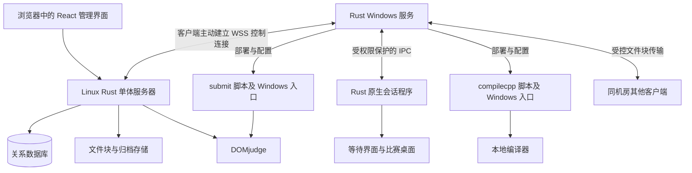

# 架构设计

状态为持续演进设计，M1、M2 工具配置及机房座位表切片已落地。需求来源见 [需求基线](requirements.md)，当前技术方向见 [ADR 0002](decisions/0002-linux-rust-stack.md)。服务端运行在 Linux，两端主实现语言采用 Rust，Web 管理界面采用 React + TypeScript + Vite。

## 组件与通信

| 组件 | 责任 |
| --- | --- |
| Server | Linux 上的 Tokio + Axum 服务，管理 API、控制连接、前端静态资源、设备注册、任务、DOMjudge 适配、审计 |
| Windows 服务 | 开机启动、身份注册、控制连接、设备事件、系统策略、文件下载和恢复任务 |
| 用户会话程序 | 显示选手身份、输入触碰提示、比赛桌面、浏览器启动、多屏处理 |
| 竞赛脚本包 | 按命令选择复用或自行实现，独立版本发布，以选手权限运行，提供稳定的参数、交互和退出码 |
| Web UI | React + TypeScript + Vite 工程，登录、座位图、选手分配、比赛控制、文件分发、告警、任务和权限页面 |
| 模拟客户端 | 并发连接、延迟、断线、重连及协议异常注入 |

控制路径和文件传输分别设置队列及资源限制。控制命令采用已定义的操作类型和参数校验，操作结果可追踪。应用开发时按这些职责创建目录，当前文档描述的是目标结构。

## 工程与部署边界

Rust 使用 Cargo workspace，共享协议类型和纯状态逻辑。服务器、Windows 服务、会话界面、运维采集工具和模拟客户端分别构建。Windows API 依赖封装在平台适配模块，Linux 服务端仅依赖跨平台部分。协议兼容性使用版本化样例验证。

选手编译和提交命令作为独立脚本包交付，可复用或自行实现，解释器及依赖离线交付。脚本与比赛配置分别版本化，具体方向见 [ADR 0003](decisions/0003-contest-script-integration.md)。

工具配置由服务端统一管理。项目提供候选工具清单，管理员选择工具并填写实际客户端文件路径。服务端生成针对目标机器的有效配置快照，包含工具 ID、显示名、文件种类、完整路径和配置版本。客户端读取快照中的逐项路径，返回存在性、可读版本资源及错误，结果携带该配置版本。未配置项返回 `not_configured`，配置路径缺失返回 `missing`，管理员据此修正配置。[ADR 0004](decisions/0004-server-managed-tool-paths.md)

M1 的只读采集器通过 `--tools-config` 读取显式 JSON 快照，用于本地验证上述检查边界。M2 首个切片已实现服务端配置存储、管理页面、授权下发和结果回传，按配置版本及任务编号区分目标配置和过期检查结果。当前落地使用单管理员、一份全局配置及目标集合、HTTP(S) 轮询和普通 Windows 进程入口。WSS、Windows 服务、权限扩展及等待界面控制后续接入，见 [ADR 0005](decisions/0005-m2-tool-configuration-slice.md)。

Web 管理端使用独立的前端工程。Node.js 用于构建，生成的静态资源随 Linux 服务端发布，由 Axum 同源提供页面、API 和 WSS 入口。客户端控制连接和管理员实时连接采用独立的权限及消息范围。HTTPS 证书与内网信任配置在部署阶段落实。

Linux 部署以服务二进制、静态资源、配置、数据库迁移和 systemd 服务定义为交付方向。应用以专用非 root 用户运行，文件存储及数据库数据使用明确的持久化位置。发行版、CPU 架构和动态库兼容性依据 Q-06 固定。

## Web 管理界面

管理端 UI 与核心业务流程以 Natsume 为参照，用户已排除打印和拍照。当前按业务分为座位总览、设备、检查任务、机房设置和工具配置，导航及视觉规则见 [界面规范](ui-design.md)。页面使用同一认证快照并保留本次登录内草稿，旧会话响应通过代次隔离。后续领域与适配边界见 [对齐记录](tasks/natsume-alignment.md)。

管理员从机房内其他机器的浏览器访问。管理端包含以下页面，每个页面都有对应的 API、权限检查、加载状态、失败反馈和可验证操作结果。

| 页面 | 功能 | 首次交付阶段 |
| --- | --- | --- |
| 登录与访问权限 | 管理员登录、退出、会话过期反馈，按角色和机房范围展示操作 | M2 |
| 机房总览与座位图 | 机房筛选、行列座位布局、IP 与选手信息、在线和检查状态、批量选择 | M2 |
| 选手与座位分配 | 名单及座位导入预览、字段错误、重复项提示、自动分配、手动调整、现场识别 | M2 |
| 机器详情与任务中心 | 环境检查、设备信息、执行阶段、错误详情、失败目标重试 | M2 |
| 工具路径配置 | 候选工具选择、自定义工具、目标路径及配置版本管理、授权下发、逐机检查结果 | M2 |
| 比赛控制 | 赛前等待、统一开放、暂停、结束、时间调整，显示已确认与未同步机器 | M2 基础操作，M3 完整安排 |
| DOMjudge 与故障换机 | 账号和 IP 绑定核对、迁移步骤、新旧机器状态及失败恢复 | M3 |
| 竞赛脚本配置 | 脚本包和配置版本、解释器检查、编译配置、发布目标、激活与回退结果 | M3 |
| 文件分发 | 上传和校验、选择目标、发布安排、逐机进度、P2P 与回源状态、补发 | M4 |
| 设备策略与告警 | USB 等事件列表、策略结果、异常确认、按机房处理 | M2 基础告警，M5 完整策略 |
| 赛后恢复 | 归档或跳过选择、目标卷信息、清理结果、重启及教学恢复状态 | M5 |
| 管理员与审计 | 角色及机房授权、操作记录、按人员和时间查询 | M2 |

选手导入和自动分配先显示可检查的结果，校验通过后提交。批量操作固定本次目标集合并显示机房和机器数量，服务端再核对权限、绑定和比赛版本。全场重启、清理等有副作用操作使用明确的目标与操作确认交互。

页面分别展示服务端期望状态、设备报告状态和最后确认时间。失联机器标记为未知或过期。客户端执行成功后才更新相应完成结果，管理员可继续查看部分失败并对允许重试的目标操作。

座位状态通过 WSS 增量同步，界面合并更新。连接中断时显示状态已过期，暂停依赖实时状态的新操作；恢复连接后获取完整快照，再应用后续事件。多管理员编辑冲突显示当前版本并支持重新加载。

管理 API 在服务端校验角色和机房范围。浏览器登录会话采用受保护 Cookie，修改操作具备 CSRF 防护，WSS 校验会话与来源。前端只保存展示所需状态，管理员凭据和 DOMjudge 密钥由服务端管理。

M2 即开展真实浏览器端到端验证，覆盖登录、导入、绑定、批量控制、状态反馈和权限拒绝。M3～M5 随业务补齐对应页面。界面具备键盘操作、清晰焦点、文字状态标签和错误定位，300 个座位状态持续更新时验证交互响应。

## 身份与数据模型

| 对象 | 核心字段和约束 |
| --- | --- |
| Room / Seat | 机房独立行列尺寸、编号规则及版本；座位有稳定 ID、行列位置、连续且机房内唯一的显示编号、预期 IP |
| DeviceSession | 注册身份、启动标识、当前来源 IP、版本、最后在线时间、能力列表 |
| ToolConfiguration | 工具 ID、显示名、种类、目标路径、配置版本和目标机器，检查结果关联同一版本 |
| Participant | 姓名、学校、参赛标识及 DOMjudge 账号引用 |
| Contest | 比赛编号、时间安排、版本、运行策略、恢复教学安排 |
| Assignment | 比赛、选手、座位、当前设备会话、绑定版本；同场有效绑定唯一 |
| Command / TargetExecution | 命令编号、每个目标的状态、结果、有效期和重试信息 |
| FileManifest | 发布编号、内容摘要、分块摘要、大小、允许目标、发布时间 |
| AuditEvent | 操作者、范围、操作、版本、结果和服务器时间 |

IP 是可核对的座位配置。注册会话和来源地址共同参与匹配，冲突进入待核对状态。硬件标识和主机名辅助识别，可信度与来源一并记录。

### 矩形机房座位表

用户于 2026-11-10 明确各机房独立设置矩形行列尺寸，座位编号连续且可自行设置。此模块已通过版本 2 迁移持久化 Room / Seat，兼容版本 1 设备、配置与历史结果。

页面按机房展示可编辑网格，支持编号起始值、起点、按行/按列/蛇形预设和自定义排列。座位号为显示属性，稳定座位 ID 对应行列位置，重新编号保留该位置的预期 IP 和已有业务关联。改变行列尺寸先预览新增、保留及移除位置，再原子更新。显示缩放独立提供紧凑、标准和放大视图。

IP 批量维护提供起始 IPv4 与步长填充、从表格粘贴座位号/IP 两列或同尺寸 IP 矩阵，以及单座位修改。顺序填充明确选择按座位号或按行列位置遍历。服务端校验地址、编号、跨座位重复绑定及机房编辑版本，冲突或校验失败时整批拒绝。

已认证设备结合服务端观察到的来源 IP 匹配座位。匹配必须唯一，未知地址进入待绑定列表，地址变化及竞争绑定展示待核对状态。代理环境需要配置受信任代理及来源地址提取，原始客户端声明地址保留为辅助证据。现场 NAT 或重叠地址空间需要进一步确定可区分的机房网络范围。

机房和座位选择可展开为工具检查的明确设备目标，页面显示未注册、离线及冲突座位。已存在的设备先进入未分配列表。机房工具检查使用独立目标预览，只为当前全局配置目标中的唯一在线设备创建任务，其余目标显示跳过原因。座位编辑不改变工具配置和目标任务。持久请求去重、乐观版本及配置头行锁保证并发事务一致。来源提取只信任配置中的精确代理 IP，地址变化需核对，离线占用持续保留，见 [ADR 0006](decisions/0006-m2-room-seating.md) 和 [实际验证记录](tasks/m2-room-seating.md)。

## 启动、发现与信任

镜像包含客户端安装、服务注册、自启动和组织公共信任配置。服务器地址可由稳定 DNS 名称或现场批量导入配置提供，同网段发现作为辅助。通过发现获得的地址仍需验证服务器身份。

克隆后的机器独立注册，使用机房部署注册材料或管理员受理流程建立本次设备身份，具体流程在 M1/M2 原型中确定。共享镜像中的公共信任根用于验证服务器，独立设备私钥在克隆后生成。凭据到期、轮换和旧会话撤销需要同时实现。

清空 D 盘或系统复原后，客户端可能失去全部本地可变状态。基础镜像必须足以重新发现、验证服务器和进入注册流程；服务器持久保存座位、绑定和任务记录。服务器离线且无有效本地安排时，客户端进入教学待机。

设备注册接口具备速率限制，重复注册和旧启动标识均需识别。管理员权限按角色和机房范围检查，浏览器会话和每条操作均需鉴权。日志中凭据脱敏。

## 模式与比赛阶段

运行模式与在线状态分别表示。比赛运行包含准备、赛前等待、进行、暂停、结束等待和恢复阶段。

| 当前情况 | 行为 |
| --- | --- |
| 教学模式且服务器离线 | 后台低频发现与重连，维持普通教学使用 |
| 教学模式且服务器上线 | 上报状态，等待明确的比赛准备指令 |
| 有效比赛安排内短暂失联 | 保持当前策略，执行已确认的本地安排并缓存有限事件 |
| 安排版本发生变化 | 核对版本、确认更新，替换尚未执行的定时动作 |
| 比赛结束 | 展示结束界面，DOMjudge 按比赛规则控制提交截止 |
| 恢复教学 | 执行本场配置的归档和恢复流程，报告结果 |

比赛结束时间、允许离线运行的有效期、恢复教学时间分别配置。涉及时间的安排使用服务器 UTC 时间、偏差估计与运行中的单调时钟。重启、时钟回拨和有效期不明时采取明确配置的异常策略，提供管理员本地恢复入口。

普通离线超时可触发已配置的非破坏性教学恢复。清盘需要针对具体比赛、目标卷和有效期的恢复任务，并在执行前核对条件，防止缓存旧任务在上课期间重放。离线恢复涉及哪些系统设置，依据复原原型确定。

## 控制协议和任务执行

命令至少携带 commandId、contestId、assignmentVersion、scheduleVersion、targetSession、issuedAt、expiresAt、operation 和参数。控制通道采用 WSS 和版本化 JSON 消息，字段定义及兼容规则在 M2 固定。重连、命令确认、去重和背压在 WCCS 协议层实现。

- 服务端将任务与目标列表持久化后发送。
- 每个目标分别报告 received、running、succeeded、failed、expired 或 cancelled。
- 接收成功和执行成功分别展示，客户端返回实际结果及错误分类。
- 按命令编号去重，结合绑定版本和启动标识阻止旧指令影响新会话。
- 修改目标状态的操作采用可重复执行的语义。重启、清理等操作通过检查点和服务器核对恢复。
- 断线后先同步最新状态和任务，再限速补传事件。历史事件有容量及保留上限。
- 多管理员更新同一比赛或绑定时使用版本冲突检测，服务端检查合法状态转换。
- 外部系统操作采用持久步骤与补偿。换机中 DOMjudge 更新失败时保留迁移中状态，支持重试和明确撤回。

协议使用版本协商和能力声明。未知或不支持的操作返回可读错误，服务端据此限制可用操作。

## Windows 会话与系统操作

系统服务处理系统权限任务，会话程序在对应用户会话运行。本地 IPC 限制调用者与允许操作。竞赛脚本、编译器及选手程序使用现有用户权限。

客户端采用 Rust，通过 windows crate 调用 Windows API。等待界面首先验证 Win32 原生窗口与消息循环。FFI 适配层集中处理句柄、内存、线程、回调生命周期及错误转换，向业务代码提供安全接口。服务和会话程序分别管理生命周期，IPC 原型采用带访问控制的命名管道。

等待界面展示姓名、学校和座位号，输入触碰触发带冷却时间的提示。原型覆盖多显示器、DPI、快捷键、程序退出、会话切换和重启。记录触碰事件时使用时间及次数，输入内容无需采集。

M1 已实现独立 `wccs-session` 开发原型，使用 Win32 STATIC / BUTTON 控件、GDI 字体和 Per-Monitor V2 DPI，每个显示器一个普通全屏窗口，共享触碰计数与 3 秒冷却。当前会话互斥量控制重复启动，WTS 通知驱动隐藏及恢复，显示器变化触发窗口重建。聚合快照记录正常结束标记，再次显式启动时识别上次异常退出。当前入口使用合成身份，后续由 Windows 服务经鉴权 IPC 驱动真实会话任务。[实现与验证记录](tasks/m1-session-waiting.md)

沿用现有用户。Windows 开机自动登录、登录界面即时登录、已有会话解锁分别做能力验证，DOMjudge IP 自动登录另行联调。管理员账户对本地限制的影响须在环境报告中展示。

USB 使用限制、安装限制和插拔事件分开验证，包含已安装设备、复合设备及志愿者替换键鼠。软件关机限制依赖系统权限配置，硬件断电通过失联检测和现场处置处理。

## DOMjudge 与竞赛命令

服务端适配器封装目标 DOMjudge 版本，优先使用受支持接口。管理员凭据保留在服务器。浏览器 IP 登录与 API 提交认证分别验证。

换机先进入迁移状态，撤销旧机器参赛绑定，更新账号 IP 并核对新机器身份，完成后放行。旧机器上线时接收撤销结果。

compilecpp 采用脚本封装本地编译器，可自行实现或适配上游。参考 WF 命令约定，明确参数和可选别名映射。本场编译器、标准和参数固定于配置，验证中文及空格路径、参数传递和编译失败后的旧产物处理。

submit 初步采用 Python 3，可复用目标 DOMjudge 配套脚本或按 API 自行实现。WCCS 下发服务器、比赛及选手配置，明确参数、确认交互和提交编号。脚本包包含可离线获得的解释器及依赖，Windows 启动器保持普通用户权限。网页 IP 登录与脚本 API 认证分别验证。超时结果进入待确认状态，依据实际 API 能力核对，避免盲目重试重复提交。

脚本包通过认证分发、摘要校验和依赖检查后激活。各版本使用独立目录，每次命令执行固定脚本和配置版本，保留正在使用的文件。包发布失败时可回退，管理页面展示各机器版本及执行阶段。M3 先通过 HTTPS 完成脚本包发布，M4 将传输接入通用分发与 P2P。

## 文件分发

服务端发布可信清单，客户端按块下载、校验并缓存，完成后原子发布到指定目录。传输支持限速、并发上限、磁盘空间预检和断点续传。文件名、解压路径和覆盖规则需要校验，防止越出目标目录。

P2P 仅分享清单授权的内容块。服务端提供有限节点列表和有时效的访问授权，优先选择同机房节点。节点掉线、块校验失败或 P2P 不可用时回源。对损坏数据源记录异常并停止采用其数据。

赛前保密包使用成熟的认证加密方案，密文可预分发，发布时释放相应密钥。缓存和上传额度同时约束，控制通道保留独立资源。取消发布、比赛切换和清理阶段停止对应上传任务。

## 归档、清理与复原

按比赛配置决定需要收集的目录、文件类型、大小上限和版本保留策略。归档清单及接收结果在服务器确认，选择跳过收集时记录选择。清理任务等待本场所需前置步骤完成。

服务端在清理前持久保存执行阶段。客户端核对部署目标卷身份、路径和任务有效期，停止相关文件传输与工作进程，处理占用并执行清理。删除不跟随越界重解析点，失败项报告给服务器。D 盘清理会移除本地任务状态，因此重启后依赖服务器核对结果，旧清理任务不能自动再次执行。

重启命令发送后，任务进入等待重新上线阶段。重新上线需报告新的启动标识、系统基线和教学状态，超时进入现场检查列表。赛后计划关闭服务器时，先确认所需清理与复原任务完成。

清盘流程在开发期通过临时目录、虚拟磁盘和测试镜像验证。当前工作区的磁盘布局与比赛目标卷配置分别管理。

## 容量与部署

300 台实际规模，500 台模拟连接为设计验收目标。心跳约 10 秒并加入随机偏移，完整指标低频或按需上报。在线状态缓存于内存，重要状态变化和审计持久化。各机房下载并发和总带宽可配置，客户端重连采用退避和随机延迟。

Web UI 合并状态增量，详细日志按需读取。文件传输与控制任务分别设置资源限制。数据库、文件存储及应用备份恢复按实际服务器部署验证。

比赛运行依赖包、字体、脚本和文档随部署交付，内网运行所需资源应可离线获得。技术选型固定后提供版本化安装包、升级与复原说明。
