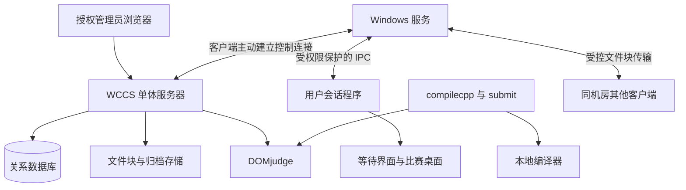

# 架构设计

状态为初始设计。需求来源见 [需求基线](requirements.md)，暂定技术选型见 [ADR 0001](decisions/0001-project-baseline.md)。

## 组件与通信

| 组件 | 责任 |
| --- | --- |
| Server | 管理员认证、机房与座位、比赛安排、设备注册、任务、DOMjudge 适配、审计 |
| Windows 服务 | 开机启动、身份注册、控制连接、设备事件、系统策略、文件下载和恢复任务 |
| 用户会话程序 | 显示选手身份、输入触碰提示、比赛桌面、浏览器启动、多屏处理 |
| CLI | 以选手权限编译和提交，保留退出码，展示可核对结果 |
| Web UI | 座位图、批量任务、异常列表、角色授权、状态增量更新 |
| 模拟客户端 | 并发连接、延迟、断线、重连及协议异常注入 |

控制路径和文件传输分别设置队列及资源限制。控制命令采用已定义的操作类型和参数校验，操作结果可追踪。应用开发时按这些职责创建目录，当前文档描述的是目标结构。

## 身份与数据模型

| 对象 | 核心字段和约束 |
| --- | --- |
| Room / Seat | 机房、座位号、布局位置、预期 IP；座位号在机房内唯一 |
| DeviceSession | 注册身份、启动标识、当前来源 IP、版本、最后在线时间、能力列表 |
| Participant | 姓名、学校、参赛标识及 DOMjudge 账号引用 |
| Contest | 比赛编号、时间安排、版本、运行策略、恢复教学安排 |
| Assignment | 比赛、选手、座位、当前设备会话、绑定版本；同场有效绑定唯一 |
| Command / TargetExecution | 命令编号、每个目标的状态、结果、有效期和重试信息 |
| FileManifest | 发布编号、内容摘要、分块摘要、大小、允许目标、发布时间 |
| AuditEvent | 操作者、范围、操作、版本、结果和服务器时间 |

IP 是可核对的座位配置。注册会话和来源地址共同参与匹配，冲突进入待核对状态。硬件标识和主机名辅助识别，可信度与来源一并记录。

## 启动、发现与信任

镜像包含客户端安装、服务注册、自启动和组织公共信任配置。服务器地址可由稳定 DNS 名称或现场批量导入配置提供，同网段发现作为辅助。通过发现获得的地址仍需验证服务器身份。

克隆后的机器独立注册，使用机房部署注册材料或管理员受理流程建立本次设备身份，具体流程在 M1/M2 原型中确定。共享镜像中的公共信任根用于验证服务器，独立设备私钥在克隆后生成。凭据到期、轮换和旧会话撤销需要同时实现。

清空 D 盘或系统复原后，客户端可能失去全部本地可变状态。基础镜像必须足以重新发现、验证服务器和进入注册流程；服务器持久保存座位、绑定和任务记录。服务器离线且无有效本地安排时，客户端进入教学待机。

设备注册接口具备速率限制，重复注册和旧启动标识均需识别。管理员权限按角色和机房范围检查，浏览器会话和每条操作均需鉴权。日志中凭据脱敏。

## 模式与比赛阶段

运行模式与在线状态分别表示。比赛运行包含准备、赛前等待、进行、暂停、结束等待和恢复阶段。

| 当前情况 | 行为 |
| --- | --- |
| 教学模式且服务器离线 | 后台低频发现与重连，维持普通教学使用 |
| 教学模式且服务器上线 | 上报状态，等待明确的比赛准备指令 |
| 有效比赛安排内短暂失联 | 保持当前策略，执行已确认的本地安排并缓存有限事件 |
| 安排版本发生变化 | 核对版本、确认更新，替换尚未执行的定时动作 |
| 比赛结束 | 展示结束界面，DOMjudge 按比赛规则控制提交截止 |
| 恢复教学 | 执行本场配置的归档和恢复流程，报告结果 |

比赛结束时间、允许离线运行的有效期、恢复教学时间分别配置。涉及时间的安排使用服务器 UTC 时间、偏差估计与运行中的单调时钟。重启、时钟回拨和有效期不明时采取明确配置的异常策略，提供管理员本地恢复入口。

普通离线超时可触发已配置的非破坏性教学恢复。清盘需要针对具体比赛、目标卷和有效期的恢复任务，并在执行前核对条件，防止缓存旧任务在上课期间重放。离线恢复涉及哪些系统设置，依据复原原型确定。

## 控制协议和任务执行

命令至少携带 commandId、contestId、assignmentVersion、scheduleVersion、targetSession、issuedAt、expiresAt、operation 和参数。具体序列化格式及协议版本在 M2 固定。

- 服务端将任务与目标列表持久化后发送。
- 每个目标分别报告 received、running、succeeded、failed、expired 或 cancelled。
- 接收成功和执行成功分别展示，客户端返回实际结果及错误分类。
- 按命令编号去重，结合绑定版本和启动标识阻止旧指令影响新会话。
- 修改目标状态的操作采用可重复执行的语义。重启、清理等操作通过检查点和服务器核对恢复。
- 断线后先同步最新状态和任务，再限速补传事件。历史事件有容量及保留上限。
- 多管理员更新同一比赛或绑定时使用版本冲突检测，服务端检查合法状态转换。
- 外部系统操作采用持久步骤与补偿。换机中 DOMjudge 更新失败时保留迁移中状态，支持重试和明确撤回。

协议使用版本协商和能力声明。未知或不支持的操作返回可读错误，服务端据此限制可用操作。

## Windows 会话与系统操作

系统服务处理系统权限任务，会话程序在对应用户会话运行。本地 IPC 限制调用者与允许操作。竞赛 CLI、编译器及选手程序使用现有用户权限。

等待界面展示姓名、学校和座位号，输入触碰触发带冷却时间的提示。原型覆盖多显示器、DPI、快捷键、程序退出、会话切换和重启。记录触碰事件时使用时间及次数，输入内容无需采集。

沿用现有用户。Windows 开机自动登录、登录界面即时登录、已有会话解锁分别做能力验证，DOMjudge IP 自动登录另行联调。管理员账户对本地限制的影响须在环境报告中展示。

USB 使用限制、安装限制和插拔事件分开验证，包含已安装设备、复合设备及志愿者替换键鼠。软件关机限制依赖系统权限配置，硬件断电通过失联检测和现场处置处理。

## DOMjudge 与竞赛命令

服务端适配器封装目标 DOMjudge 版本，优先使用受支持接口。管理员凭据保留在服务器。浏览器 IP 登录与 API 提交认证分别验证。

换机先进入迁移状态，撤销旧机器参赛绑定，更新账号 IP 并核对新机器身份，完成后放行。旧机器上线时接收撤销结果。

compilecpp 固定编译器路径、标准和参数，处理中文及空格路径，失败时清理或隔离过期可执行输出。submit 明确比赛、题目、语言和源文件，成功返回提交编号。超时结果进入待确认状态，依据实际 API 能力核对，避免盲目重试重复提交。

## 文件分发

服务端发布可信清单，客户端按块下载、校验并缓存，完成后原子发布到指定目录。传输支持限速、并发上限、磁盘空间预检和断点续传。文件名、解压路径和覆盖规则需要校验，防止越出目标目录。

P2P 仅分享清单授权的内容块。服务端提供有限节点列表和有时效的访问授权，优先选择同机房节点。节点掉线、块校验失败或 P2P 不可用时回源。对损坏数据源记录异常并停止采用其数据。

赛前保密包使用成熟的认证加密方案，密文可预分发，发布时释放相应密钥。缓存和上传额度同时约束，控制通道保留独立资源。取消发布、比赛切换和清理阶段停止对应上传任务。

## 归档、清理与复原

按比赛配置决定需要收集的目录、文件类型、大小上限和版本保留策略。归档清单及接收结果在服务器确认，选择跳过收集时记录选择。清理任务等待本场所需前置步骤完成。

服务端在清理前持久保存执行阶段。客户端核对部署目标卷身份、路径和任务有效期，停止相关文件传输与工作进程，处理占用并执行清理。删除不跟随越界重解析点，失败项报告给服务器。D 盘清理会移除本地任务状态，因此重启后依赖服务器核对结果，旧清理任务不能自动再次执行。

重启命令发送后，任务进入等待重新上线阶段。重新上线需报告新的启动标识、系统基线和教学状态，超时进入现场检查列表。赛后计划关闭服务器时，先确认所需清理与复原任务完成。

清盘流程在开发期通过临时目录、虚拟磁盘和测试镜像验证。当前工作区的磁盘布局与比赛目标卷配置分别管理。

## 容量与部署

300 台实际规模，500 台模拟连接为设计验收目标。心跳约 10 秒并加入随机偏移，完整指标低频或按需上报。在线状态缓存于内存，重要状态变化和审计持久化。各机房下载并发和总带宽可配置，客户端重连采用退避和随机延迟。

Web UI 合并状态增量，详细日志按需读取。文件传输与控制任务分别设置资源限制。数据库、文件存储及应用备份恢复按实际服务器部署验证。

比赛运行依赖包、字体、脚本和文档随部署交付，内网运行所需资源应可离线获得。技术选型固定后提供版本化安装包、升级与复原说明。
